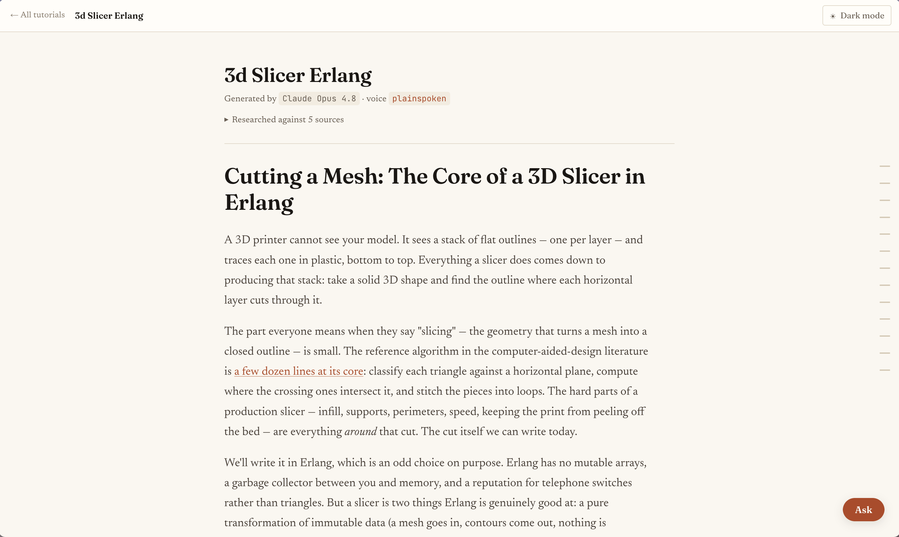
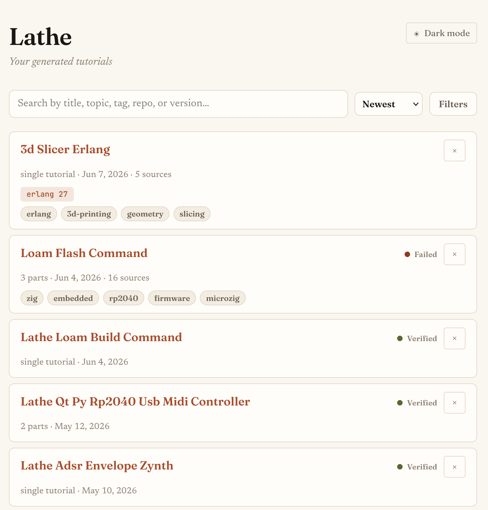
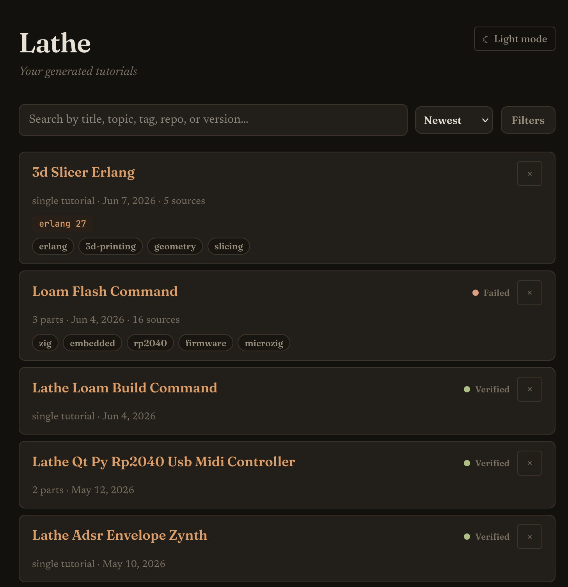
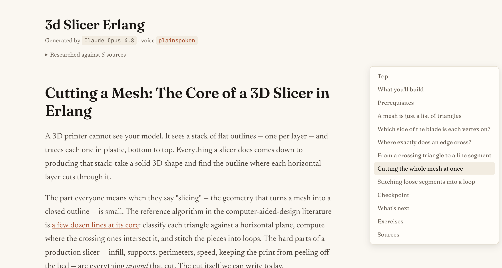
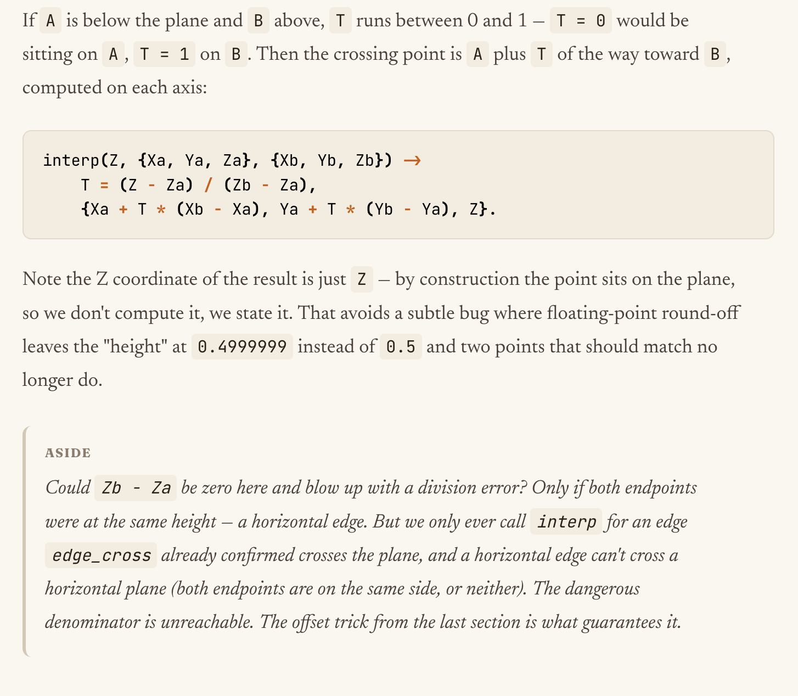
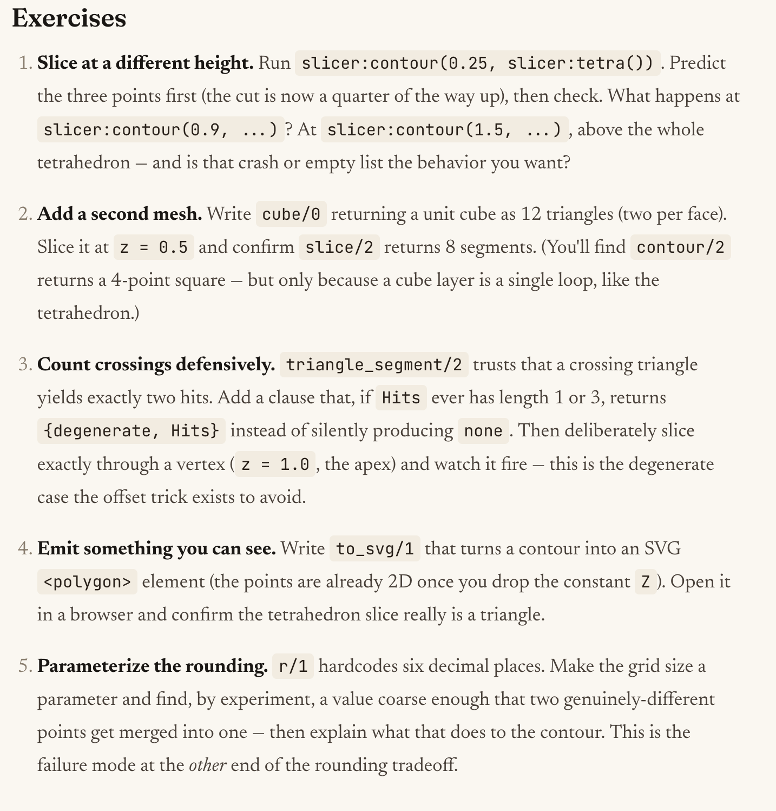
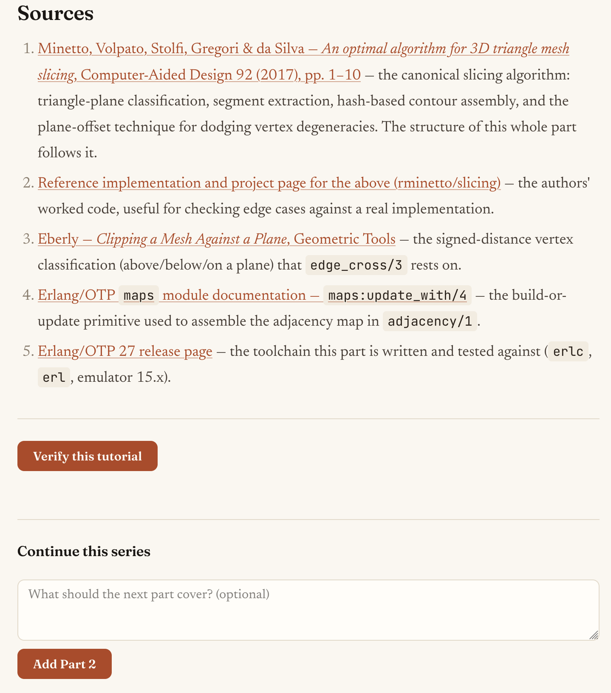

# Lathe

An experiment in using LLMs to teach you, rather than think for you.

Lathe generates hands-on, multi-part technical tutorials on demand, with skills tuned to make content approachable. Then you work through them yourself, by hand, in a local UI built from the ground up for pleasant learning. (Just like we did it in the stone age 😎)



## What is it?
- Generate hands-on technical tutorials (single-part or a multi-part series) from any prompt
- Work through the tutorial yourself in a purpose-built local UI
- Use skills to ask questions, verify the tutorial, and extend it with a new part
- Search, filter, and manage tutorials from your library
- Every tutorial documents its sources, which model was used, and what prompt drove the "voice" for the tutorial

## Quick start

Lathe is a combination of LLM skills and a Golang CLI used to store, manage, and view generated tutorials. After install (below), you can generate a tutorial inside any coding agent (Claude Code, Cursor, Codex, Gemini CLI, opencode, Cline, and Windsurf supported) by prompting something like:

```
/lathe build a 3D Slicer in Erlang
```


Then open the Lathe app, or start the reader from any terminal:

```bash
lathe                    # opens the desktop app (when installed)
lathe serve              # or: starts the web server, opens the browser
```



Don't worry, we also have dark mode:



Click the tutorial you want to read and start learning! 

The CLI has a bunch of other commands, but honestly those were built to give the LLM a deterministic way to manage tutorials. I expect the above to be all you need (it's all I ever use) for day-to-day. If you want to ask a question about a tutorial, have the LLM verify it, or extend it with an additional part, the UI has affordances for each of these.

There are three ways those buttons work:

- **Hosted agent (experimental):** the reader has an **agent panel** docked on the right (a slim rail when you collapse it, a bottom sheet on phones, and it can pop out into its own window). The first time, it shows **Bring your agent**: the coding agents it finds on your `PATH` that speak the [Agent Client Protocol](https://agentclientprotocol.com) (Claude Code, Codex, Gemini CLI, opencode, Goose), whether each already has Lathe's skills, and how to install a missing ACP adapter (Claude Code needs `npm install -g @agentclientprotocol/claude-agent-acp`; Codex needs Zed's [`codex-acp`](https://github.com/zed-industries/codex-acp)). Pick one and Lathe starts it and remembers the choice in `~/.lathe/config.json`, so the next `lathe serve` starts it too. The panel header is one chip with its name and what it is doing beside it ("Waiting for jobs", "Verifying the tutorial", …); the chip's menu shows the model it reports and its file access, and has Workspace…, Switch agent, Open in new window, Restart agent and Agent settings…. The **+** button in the question box (or typing `/` in an empty box) opens the actions: **Check my work**, **Verify tutorial** and **Write Part N**, each saying why when it can't run yet. You can also name any ACP command yourself with `lathe serve --agent <cmd>`, which wins over the saved choice. `lathe serve` runs that agent as a child process, and **Ask** streams its answer straight into the panel. **Verify this tutorial** and **Add a part** run there too: the page shows the agent's plan, each step it takes and its closing report live, with a **Stop** button (or `lathe verify-cancel <slug>` from a terminal). If a run stops before it records a result, Lathe puts the status back the way `lathe verify-cancel` does and discards a half-written part. When the agent wants to use a tool, the panel shows its request with **Allow / Deny** buttons. If the agent fails to start or exits, the panel says so and hands you the copy-paste command instead; your next question restarts it. Each session also gets Lathe's own MCP server (`lathe mcp`, scoped to that tutorial), so the agent records results with typed tools like `lathe_verify_result` instead of shelling out to `lathe`. Lathe also offers the agent its own file and terminal access over ACP and limits each job to its directories: Ask may read the tutorial and nothing else, so writes and commands are refused (the panel shows each file read and each "Blocked by Lathe" refusal). Verify may read the tutorial and write and run commands only in a fresh scratch dir Lathe makes for the run (and deletes afterwards); Add a part may also write into the tutorial dir. Agents that route file access through Lathe show file access **Enforced** in the chip's menu; an agent that keeps using its own built-in tools shows **Soft**, which means its own permission prompts are the boundary. Either way this is a policy Lathe applies, not an OS sandbox. The two options below stay as the fallback for agents without ACP support, or when you'd rather watch the work in your own terminal.
- **Live mode (no copy-paste, any agent):** run `/lathe-work` once in your coding agent while `lathe serve` is running. That starts a small worker loop, the agent panel shows "Connected via /lathe-work", and the **Ask / Verify this tutorial / Add a part** buttons drive the work directly in that session — the answer renders right in the reader, verify and extend update in place. Works in any supported agent. Stop the loop any time; the buttons just revert to copy-paste.
- **Copy-paste fallback (no worker connected):** each button hands you the exact `/lathe-*` command to paste into your LLM to trigger the action.

**Workspace.** Each tutorial can remember the folder where you type its code: set it in the agent panel's setup or the workspace button under its header, or from a terminal with `lathe start <slug> [path]` (default: the current directory), which then opens the tutorial if `lathe serve` is running. Lathe creates the folder if needed and runs `git init` when it is empty. The path lives in the tutorial's local `workspace.json` beside your reading progress, never in its `metadata.json`.

**Library.** The list page opens on **Home**: a *Pick up where you left off* row (a **New tutorial** cover that opens the New tutorial sheet, then anything being written, then what you're partway through, most recently read first), then one row per shelf. The sidebar links **All tutorials** (searchable and filterable), **Being written**, each shelf, the languages your tutorials use, and **Needs a look** (failed verification). Every tutorial sits on exactly one shelf; until it's filed it is **Unsorted**. Make a shelf with **+ New shelf** in the sidebar or `lathe shelf new <name>`. To file a tutorial, drag its cover onto a shelf in the sidebar, use the cover's **⋯** menu › **Move to shelf**, or run `lathe shelf set <slug> <shelf>` (`lathe shelf list` shows them). Each shelf has its own page with a one-line description, **Sort** (Recently read, Newest, Title) and **Group by** (None, Language, Status: In progress, Needs a look, Verified, Not started); a language only one tutorial uses folds into *Other languages*. Rename, describe or delete a shelf from the **⋯** beside its title; deleting a shelf moves its tutorials to Unsorted. Shelves live in `~/.lathe/shelves.json`, outside every tutorial, so re-storing one never loses its shelf.

**New tutorial.** ⌘N (Ctrl+N; in a browser, which keeps ⌘N for itself, use the title bar's **New tutorial** button, the blank cover on Home, or ⌘K and "New tutorial about “…”") opens a sheet that asks `/lathe`'s setup questions up front: what to build, which shelf it goes on (suggested from what's on your shelves), where you're starting from, the voice, the folder you'll type the code in (`<code folder>/<slug>`, with Choose folder… in the desktop app) and, folded away, the versions and repo it found there. **Start writing** (⌘↩) runs `/lathe` on your hosted agent with those answers, so it only asks what is still unclear; with no agent set up it gives you the `/lathe …` command, flags and all, to paste into your coding agent.

**Trash.** A cover's **⋯** menu (also on right-click) has Open, Add a part, Verify again, Move to shelf, Show workspace in Finder (desktop app) and **Move to Trash** (⌘⌫ in the desktop app on macOS). Nothing asks "are you sure?": the tutorial moves to `~/.lathe/trash/` and a toast offers **Undo** (⌘Z / Ctrl+Z while it shows). `lathe rm <slug>` moves to the Trash too; `lathe rm --now <slug>` deletes permanently. The Trash keeps tutorials for 30 days by default (**Settings › Library › Trash**: 7 days, 30 days or Never), and **Show Trash** lists them with **Restore** and **Delete now**. Restoring puts a tutorial back on its shelf. Expired entries are deleted when `lathe serve` (or the app) starts and on each `lathe rm`.

**Check my work.** Once a workspace is set, each part's `## Checkpoint` ends with a **Check my work** button (or run `/lathe-check <slug> [part]` yourself). Your agent copies your workspace to a scratch dir (your files are never changed: on the hosted agent Lathe refuses its writes and commands anywhere but the copy), runs the checkpoint there and compares your code with the part by meaning, guided by the verified code snapshot's diff for that part when there is one (without a snapshot the result is marked lower-confidence). The result appears under the checkpoint as a hint ladder: a nudge first, then **Another hint** (the step that covers it), **Show me where** (the file and roughly where), and only if you ask, **Reveal the reference code**. Passing code that differs from the reference is listed as a choice, not a mistake, with a heads-up when a later part builds on the reference shape. Results are appended to the tutorial's local `checks.jsonl`.

Whichever way you use, your own agent does the model work, under your own login. The `lathe` binary never calls a model API itself.

## Install

### Desktop app (recommended)

The desktop app is the same reader in its own window, with your coding agent in the agent panel. It doesn't need a terminal or a localhost tab, and adds a native folder picker for your workspace, a system notification when Verify, Extend or Check my work finishes, a real window for the agent panel's pop-out, and links to other sites open in your browser. It's the same `lathe` binary: `lathe` with no arguments (or `lathe app`) opens the app, and every subcommand works as before.

- **macOS 12+:** `brew install --cask devenjarvis/tap/lathe` installs `Lathe.app` into `/Applications` and puts `lathe` on your `PATH`. Or download `Lathe_<version>_macos_universal.zip` from the [latest release](https://github.com/devenjarvis/lathe/releases/latest) and drag `Lathe.app` into Applications. The app is signed and notarized.
- **Windows 10/11:** download `lathe_<version>_windows_amd64.zip` (or `_arm64`) from the [latest release](https://github.com/devenjarvis/lathe/releases/latest), unzip it, and run `lathe.exe`. Double-clicking it opens the app; in a terminal it's the CLI. It uses the WebView2 runtime that ships with Windows.
- **Linux:** build it from source for now. The release binaries for Linux are CLI-only. On Ubuntu 24.04:

  ```bash
  sudo apt install libgtk-4-dev libwebkitgtk-6.0-dev
  CGO_ENABLED=1 go install -tags desktop,production github.com/devenjarvis/lathe@latest
  ```

  Without a display (`DISPLAY`/`WAYLAND_DISPLAY` unset, e.g. over SSH), `lathe` prints its help as before.

`lathe work` (the `/lathe-work` loop), `lathe start` and `lathe verify-cancel` find the running app the same way they find `lathe serve`. Opening Lathe a second time brings the existing window forward.

**The app can't find my agent.** Apps opened from the Dock don't get the `PATH` your shell sets up. When it starts, Lathe runs your login shell once (`$SHELL -i -l`, with a 5-second limit) and picks up its `PATH`. If your agent still isn't found (it's installed somewhere your shell files don't add, or your shell is csh, tcsh or nu), list its directory in `~/.lathe/config.json`:

```json
{
  "agent_path": ["~/.nvm/versions/node/v22.11.0/bin", "/opt/homebrew/bin"]
}
```

These directories are searched before `PATH` by both the app and `lathe serve`. If your shell startup files are slow or interactive, skip that work during the probe with `[ -n "$LATHE_RESOLVING_ENVIRONMENT" ] && return` (fish: `set -q LATHE_RESOLVING_ENVIRONMENT; and return`).

### CLI only

The CLI is a single self-contained binary. All you need is `lathe` on your `$PATH`; the
skills run in an interactive coding-agent session (Claude Code, Cursor, Codex, Gemini
CLI, opencode, Cline, or Windsurf). `lathe serve` opens the reader in your browser.

**Homebrew** (macOS): the cask above also gives you the `lathe` CLI.

**Install script** (`curl | sh`, macOS and Linux, CLI-only binary):

```bash
curl -sSf https://raw.githubusercontent.com/devenjarvis/lathe/main/install.sh | sh
```

**Go** (needs Go 1.26+; CLI only, add `-tags desktop,production` with cgo for the app):

```bash
go install github.com/devenjarvis/lathe@latest
```

**From source:**

```bash
git clone https://github.com/devenjarvis/lathe
cd lathe
go build -o lathe                                   # CLI
go build -tags desktop,production -o lathe .        # CLI + desktop app (cgo; see Linux deps above)
```

### Install the skills

The skills are bundled into the binary. After installing `lathe`, drop them into a
project so your coding agent can discover them:

```bash
lathe skills install                   # ./.claude/skills/<name>/SKILL.md (this project)
lathe skills install --user            # ~/.claude/skills/<name>/SKILL.md (all projects)
lathe skills install --agent cursor    # ./.cursor/commands/<slug>.md (Cursor slash commands)
lathe skills install --agent codex     # ./.agents/skills/<name>/SKILL.md (Codex Agent Skills)
lathe skills install --agent gemini    # ./.gemini/skills/<name>/SKILL.md (Gemini CLI)
lathe skills install --agent opencode  # ./.opencode/skills/<name>/SKILL.md (opencode)
lathe skills install --agent cline        # ./.cline/skills/<name>/SKILL.md (Cline)
lathe skills install --agent windsurf     # ./.windsurf/skills/<name>/SKILL.md (Windsurf)
lathe skills install --agent antigravity  # ./.antigravity/skills/<name>/SKILL.md (Antigravity)
lathe skills install --agent all          # every target above
lathe skills list                      # show the bundled skills
```

`SKILL.md` (name + description frontmatter) is now a cross-tool standard, so every
target except Cursor ships the raw skill verbatim — Claude Code, Codex, Gemini CLI,
opencode, Cline, and Windsurf all read it as-is, and `--user` installs to that agent's
home dir (Cursor and Windsurf are project-only and warn + fall back). Cursor is the
lone translation case: its commands are slash-invoked as `/<slug>` (e.g. `/lathe`).
The interactive handoff model is documented against Claude Code, so a few runtime
details differ on the other agents.

### Local / self-hosted models

Lathe doesn't talk to any model itself, so a local LLM needs no Lathe-specific setup:
point your coding agent at a local OpenAI-compatible endpoint (e.g. [Ollama](https://ollama.com/)'s
`http://localhost:11434/v1`) and run the `/lathe` skills exactly as above. The bigger
the local "thinking" model you can run, the better the tutorials — these are research-
and explanation-heavy tasks, not mechanical edits.


## Why does this exist?

I learned how to program as a teen in the 2000s by building homebrew games for my PSP (PlayStation Portable) in Lua, and then in C++. Lots of what I learned at the time was through the small PSP homebrew community I'm incredibly grateful I got to be a part of, but I also owe much of that formative learning to free online resources and tutorials available on the internet (shoutout to [2007 cplusplus.com](https://web.archive.org/web/20070213043837/http://www.cplusplus.com/articles/Sacha1.html) - man does that site have a lot more ads now than it used to 😅). Eventually I became a professional software engineer and I spent the next decade "upskilling" (though usually to learn more interesting topics than needed for <dayjob>) by finding and consuming a wealth of technical blogs, and more importantly for my learning style - hands on tutorials. Resources like the [build-your-own-x repo](https://github.com/codecrafters-io/build-your-own-x), and [Crafting Interpreters](https://craftinginterpreters.com/), and the 1,000 other one-off tutorials that taught me everything from building [a raytracer](https://raytracing.github.io/books/RayTracingInOneWeekend.html), to [a timeseries database](https://nakabonne.dev/posts/write-tsdb-from-scratch/), to [a linear algebra matrix library](https://www.andreinc.net/2021/01/20/writing-your-own-linear-algebra-matrix-library-in-c/) and everything in between (seriously, I couldn't even begin to list all the amazing hands-on tutorials out there that have influenced me). 

Hands on learning is how I've always learned best. These tutorials gave me the learning curve I needed to go from zero-to-one in a brand new domain, but even more importantly they gave me footing and confidence to take it from one-to-two-to-ten on my own. 

Fast forward to 2026, and now we've got LLMs. I'm not going to go off topic about my complicated relationship with LLMs, but for writing software they are _interesting_ and in many cases they can be really productive! But they do most of the work for you, and with that work gone they also take away the part that helped me learn a new concept or domain. In some cases, that doesn't matter - we've got a product to ship and LLMs help us ship it faster - but for me and my joy in this field and hobby I still crave those "ah ha!" moments where something finally clicks and I have the confidence I need to begin shaping it into my own.

So lathe is an experiment in using LLMs to teach me, rather than think for me. To recreate those moments of hands-on learning that taught me to love this work, and marry it with the _potential_ of a broad "expert" LLM who can, in theory, teach me anything. I use lathe as a catalyst to get me started on projects I wouldn't know how to start in, and **can't find any existing human written resources to teach**. For example I first came up with lathe because I wanted to write a 3D Slicer Software from scratch (just finding documentation on g-code was a pain, shoutout to [reprap](https://reprap.org/wiki/G-code)). At the time of writing I'm diving into the world of embedded software development with Zig. Both of these cases lathe has been an effective tool in getting me from zero-to-one in obscure or extremely young domains where the human written resources just don't exist yet (and I wonder for how long humans will still bother writing tutorials if only the LLMs read them...).

## But what about hallucinations?

Are lathe tutorials as good as ones written by humans? Not in the slightest. But what they lack in heart, personality, and architectural soundness, they make up for by having the tutorial writer ready and waiting to answer all of your questions, always willing to fix or update their tutorial when it isn't _exactly_ what you wanted, and they actually complete writing all 6 parts to that series they started in 2018 (we've ALL been there 😁). Lathe is an LLM, and while I've built and tuned it to be as good as I know how to make it for this particular task, it's still going to fail in the ways LLMs fail. I recommend using the biggest "thinking" model you have access to (Opus, GPT-5 Codex, etc) as these tasks are less about iterative mechanical execution you might optimize for when programming, and more about researching, designing, and explaining a tangible concept from start to finish. 

Additionally, the risk for hallucinations in this context is, in my opinion, significantly lower. Lathe is built to help _you_ do the thinking, and is built around the expectation that you're the one typing this code out yourself. By reading through the guide and typing it out, you are actively engaged in the work and should be well positioned to naturally ask "wait, does that make sense?" when you come across something weird. At which point you can `/lathe-ask` (and sometimes the LLM comes back with _good_ reasoning I didn't have because it's a foreign domain, and I learn something) or just straight tell your LLM to update the tutorial. While I have no pedagogical credentials to back this up, I think I may be actually internalizing concepts better by catching and pushing back on perceived slip-ups of the LLM. YMMV. 

All of that said, if you can find a tutorial written by a human, I'd always reach for that first. I hope more often than not you do. But if you learn the same way I do and want to dive into a domain that is light on teaching materials, lathe is a pretty cool tool. Just remember it is an LLM and not a human. To help with this, I try to make it clear at all times what you are and are not getting. The lathe skills to write tutorials will tell you when it isn't sure about something it has written, and while I offer a more "personal" voice, I've defaulted to one that doesn't pretend to be something it isn't. 

## Be honest, did you vibecode this? Isn't that contradictory to your thesis?

Yep, lathe is "vibecoded". In this case, the scope and risk of lathe is low. It's a living thesis, for personal learning. That said, I've been using it daily lately and it's proven to be a useful and stable tool in my toolbox. I'm learning a lot by using it, and at this point I think it's good enough that others might benefit from it too. I expect the next few point releases to be some intentional code/architecture clean up to ensure it remains stable for others, and of course incorporate any feedback I get. 

That said, for the sake of transparency, today I test lathe for my own usecases - using Claude Code on macOS. Lathe is built to be agent-agnostic (the skills are a cross-tool standard and the CLI never calls a model itself), so other agents and platforms _should_ work, but I've only verified my own setup. If you're willing to try it on a different agent or OS and it does work, or you end up hitting a bump in the road, I'd love an issue letting me know either way!

## Alright then, how does it work?

- **LLM skills** — generate and work with tutorials, all run in your interactive coding-agent session: `/lathe` writes `part-01.md`, `/lathe-extend` adds the next part, `/lathe-verify` works through a tutorial to confirm it compiles and runs, `/lathe-ask` answers questions about a part you're reading, `/lathe-check` checks the code you typed for a part and answers with hints, `/lathe-tag` adds search tags to existing tutorials, `/lathe-shelf` proposes shelves for your library (or a split of a shelf that grew too big) for you to review and apply, and `/lathe-work` runs a worker loop so the web buttons drive Ask/Verify/Extend directly (see [live mode](#quick-start) above).
  - **The binary hosts your own agent; it never calls a model API itself.** Model work runs in the agent you chose: in your interactive session (via the skills and `/lathe-work`), or in the agent `lathe serve --agent` starts for you over ACP. Either way it runs on whatever subscription or endpoint that agent uses, and Lathe never runs `claude -p`.
  - **Billing for the hosted agent (checked 2026-11-06).** Claude's ACP adapter is built on the Claude Agent SDK. Anthropic paused the planned 2026-06-15 metering of Agent SDK, `claude -p` and third-party-app use, and as of its 2026-10-07 update, use signed in with a Claude plan still draws from your subscription limits ([Anthropic](https://support.claude.com/en/articles/15036540-use-the-agent-sdk-with-your-claude-plan), [Zed](https://zed.dev/blog/anthropic-subscription-changes)). Anthropic has said it will give notice before any change. If metering returns, a hosted Claude agent would likely count as Agent SDK use rather than interactive use. `/lathe-work` is not affected, because it runs in your interactive session. Codex over `codex-acp` accepts a paid ChatGPT plan login, and API keys are optional ([codex-acp](https://github.com/zed-industries/codex-acp)).
- **`lathe` CLI** (Go) — copies tutorials into `~/.lathe/tutorials/`, serves the rendered output at `http://localhost:4242`, and owns all durable state. It never calls an LLM API itself. With `--agent`, `lathe serve` hosts your agent over ACP for Ask, Verify and Add a part. When a `/lathe-work` worker is connected, the web buttons enqueue a job for that session to pick up; otherwise they hand you the skill command to paste. Either way the skills do the model work and call back into the CLI (`lathe store`, `lathe verify-result`, `lathe extend-start`/`extend-commit`, `lathe check-result`, `lathe voice add`, and `lathe work next`/`answer`/`done` for the worker loop) to record results and close out jobs. `lathe mcp` serves those same write commands as MCP tools over stdio (`lathe_store`, `lathe_verify_result`, `lathe_extend_start`, `lathe_extend_commit`, `lathe_tag`, `lathe_check_result`, `lathe_voice_add`); a hosted agent gets it automatically, and you can add it to any MCP-capable agent's config. The skills use the tools when they're present and the CLI otherwise.

## What's up with the fancy UI?

I'm glad you asked! The lathe skills and CLI were built in tandem to offer (what I think is) a great reading and learning experience. A few key features that make using lathe worth more than just prompting Claude directly (for me) are:

### Full table of contents navigation if you hover on the right side bar



### Content is written with side-notes throughout to prompt me to think more deeply



### Left-to-the-reader Exercises at the end of each tutorial



## Writing voices

Every tutorial is written in a **voice**. A voice controls *how the prose sounds* but it doesn't change accuracy, research, citation, verification, or structure, which are fixed. Two voices ship with lathe:

- **`plainspoken`** (the default) — honest and precise, with no invented persona
  or fabricated first-person war stories. It's written to avoid anthropomorphizing
  the LLM that produced it.
- **`companion`** — an attempt at a warm, wry, first-person "friend at the keyboard".

Pick one per run by naming it in your `/lathe` invocation (*"…in the companion
voice"*), or change the global default:

```bash
lathe voice list                     # see what's available; * marks the default
lathe voice show companion           # print a voice's full spec
lathe voice set-default companion    # change the default for new tutorials
```

**Custom voices.** If you don't like the voices that come with lathe that's cool, you do you. You can author your own with `/lathe-voice` in an LLM session, and it'll interview you about register, person, and humor, draft a spec, and (on
your approval) save it via `lathe voice add <name> --file -` into
`~/.lathe/voices/`. With a hosted agent you can do the same in the app: **Settings › Voices › New voice** — describe the voice, and your agent drafts the ring buffer sample in it, which you refine with a click (Shorter, Warmer, …) or your own words before you save.

Custom voices are instructed to not impersonate a real named person, fabricate credentials, or deny LLM authorship. `/lathe-voice` refuses those, and every voice is wrapped with a fixed preamble enforcing the same at generation time. The voice a tutorial was written in is recorded on it (so `/lathe-extend` continues in it) and is disclosed in an authorship byline at the top of every tutorial: `Generated by <Model> · voice <name>` where the model is the specific LLM used to generate the tutorial (e.g. "Claude Opus 4.8"), and the voice name expands to reveal the full spec. 

I fully recognize this is a cat and mouse game, and that any attempts at safety here can be circumvented. Unfortunately, whether I publish lathe or not the bad actors who want to flood the world with AI slop tutorials are already going full steam ahead. I want to do my part though to make it clear that lathe is NOT intended for writing content outside of your personal use for your personal learning. 

## Finding tutorials

As your library grows, the web list page (`lathe serve`) has a search box and filters to narrow it down — all client-side, so it stays fast and offline:

- **Search** matches a tutorial's title, topic, tags, repo, and tool versions.
- **Sort** by newest, oldest, or title (A–Z).
- **Filter** by status, by type (single vs. series), by tag, and by version.

Default port is `4242`; override with `--port`.

## Storage layout

Tutorials live globally in `~/.lathe/tutorials/`, one directory per slug:

```
~/.lathe/tutorials/
  digital-synth-zig/
    metadata.json
    part-01.md
    part-02.md
    part-03.md
  database-from-scratch-go/
    metadata.json
    index.md
```

`metadata.json`:

```json
{
  "slug": "digital-synth-zig",
  "title": "Build a Digital Synth in Zig",
  "topic": "build a digital synth in Zig",
  "created": "2026-05-03T19:00:00Z",
  "status": "unverified",
  "tags": ["zig", "audio", "dsp"],
  "parts": ["part-01.md", "part-02.md", "part-03.md"],
  "tools": [{ "name": "zig", "version": "0.13.0" }],
  "sources": ["https://ziglang.org/documentation/0.13.0/"],
  "voice": "plainspoken",
  "model": "Claude Opus 4.8"
}
```

Everything beyond the core fields (`slug`/`title`/`topic`/`created`/`status`) is optional and omitted when empty: `tools` (the languages/toolchains the tutorial targets, surfaced as version chips and the **Versions** filter), `sources` (the research trail — see below), `voice` and `model` (the byline on the reading page), and `repo`/`repo_branch` when a tutorial was written against a specific git repository.

Reader state sits beside it in small sidecars that never touch `metadata.json`: `progress.json` (your reading position), `exercises.json` (checked-off exercises), `workspace.json` (the folder where you type the code, set with `lathe start` or the agent panel) and `checks.jsonl` (one line per "Check my work" result; dropped on re-store, like `progress.json`). Which shelf a tutorial is on is reader state too, kept library-wide in `~/.lathe/shelves.json` (`{"version":1,"shelves":[{"id":"systems","name":"Systems","description":"…"}],"placements":{"<slug>":"systems"}}`). A deleted tutorial's folder moves to `~/.lathe/trash/<slug>-<time>` until it is restored or purged; its placement stays until then.

Status is one of `unverified` (the default after `lathe store`; renders no badge), `verifying`, `verified`, `failed`, `skipped`, `extending` (set while `/lathe-extend` is writing a new part), or `writing` (a new tutorial the hosted agent is writing from the **New tutorial** form; Lathe reserved its slug and removes the placeholder if the run ends without storing). On failure, a `verify-result.json` is written alongside with the failed part, step number, and error output; the web UI renders it as a panel on the tutorial page.

## Sources & provenance

Every tutorial keeps the research trail behind it — the URLs the generation skill actually consulted while writing. This is distinct from the inline `## Sources` citations inside a part's markdown: it's a durable, tutorial-level record stored in the `sources` field of `metadata.json` and surfaced in the UI as provenance, so you can sanity-check where the material came from rather than taking the prose on faith.

- `/lathe` captures them via `lathe store --source <url>` (repeatable), and `/lathe-extend` folds any newly-consulted URLs into the same trail (`lathe extend-commit --source`), de-duped against what's already there. Pass a title in front of the URL — `--source "Architecture overview|https://example.com/arch"` — and the reading page uses it as the link text, falling back to the URL itself when no title is given.
- On the **list page**, each card shows a `· N sources` count in its metadata line.
- On the **reading page**, a *"Researched against N sources"* panel expands to the full list of links.




## Verification

Verification is **opt-in** and runs in your interactive LLM session. Storing a tutorial leaves it `unverified` and nothing runs until you ask. With a hosted agent (`lathe serve --agent`), the **Verify this tutorial** button runs it there and the page shows its progress live. With a `/lathe-work` worker connected, the **Verify this tutorial** button kicks it off directly in that session. Otherwise — and via the `lathe verify <slug>` command or the `--verify` flag on `lathe store` — you get the same command to paste into your session:

```
/lathe-verify <slug>
```

The `/lathe-verify` skill works through every step in the tutorial, creating files in a fresh `mktemp -d` scratch dir (never your repo), running commands, executing each `## Checkpoint` block and then calls `lathe verify-result` to record the outcome in the tutorial's `metadata.json`. It marks the run `verifying` when it starts and a terminal `verified` / `failed` / `skipped` when it finishes.

### Code snapshots

While it verifies, `/lathe-verify` commits the reconstructed code after each part's checkpoint passes and tags it `part-01`, `part-02`, … When the run finishes, `lathe verify-result --code` saves that history into `~/.lathe/tutorials/<slug>/code/` (a failed run keeps the parts that passed). That gives you the complete, runnable codebase at every step, including the "now you write one" pieces, so you can see exactly what a part changed:

```bash
git -C ~/.lathe/tutorials/<slug>/code checkout part-04
git -C ~/.lathe/tutorials/<slug>/code diff part-03 part-04
```

The reading page shows those commands for the part you're on once a snapshot exists. Only committed source is kept (dependency and build-output dirs are excluded), re-verifying replaces the snapshot, and re-storing the tutorial drops it. Run `/lathe-verify <slug> --no-save` to verify without keeping the code.

If a verification is interrupted (the session died, or you started it by mistake) and the badge is stuck on verifying, `lathe verify-cancel <slug>` stops it — including a run on the hosted agent — and restores the previous result.

Verification only makes sense where the tutorial's toolchain is installed. If a required tool is missing (e.g. no `zig` binary), the run is reported as **skipped** (⚠️) rather than failed — "couldn't verify here" is not the same as "broken."

Because verification now runs in your own interactive session, it executes under your normal LLM permission model, so you see and approve the tool calls. The scratch-dir convention keeps build artifacts out of your repo, but treat it as soft isolation at best, not a security boundary.
