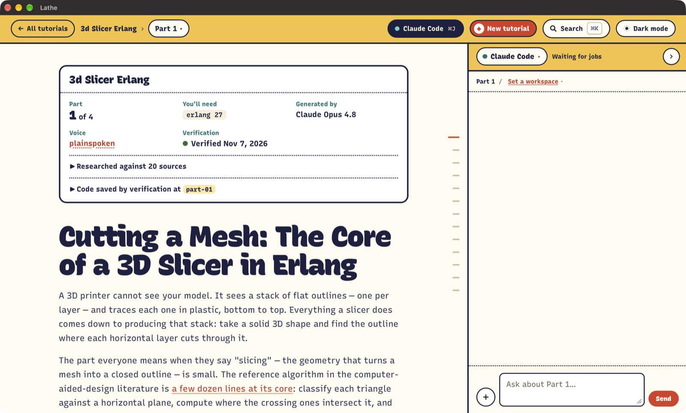
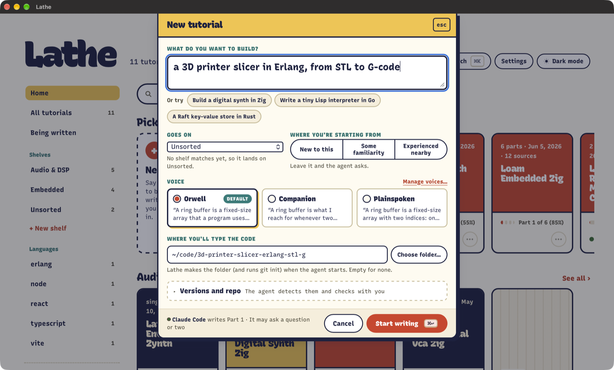
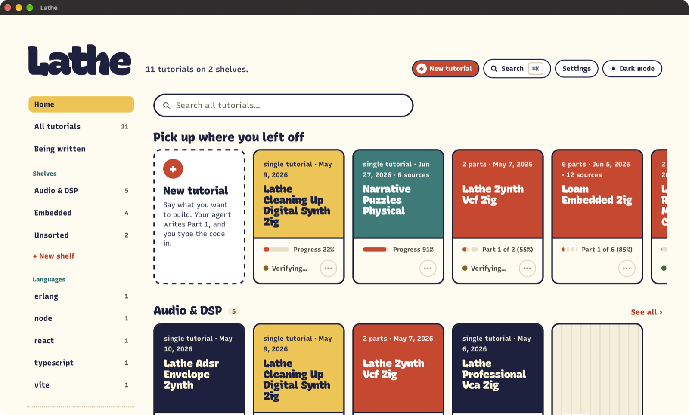
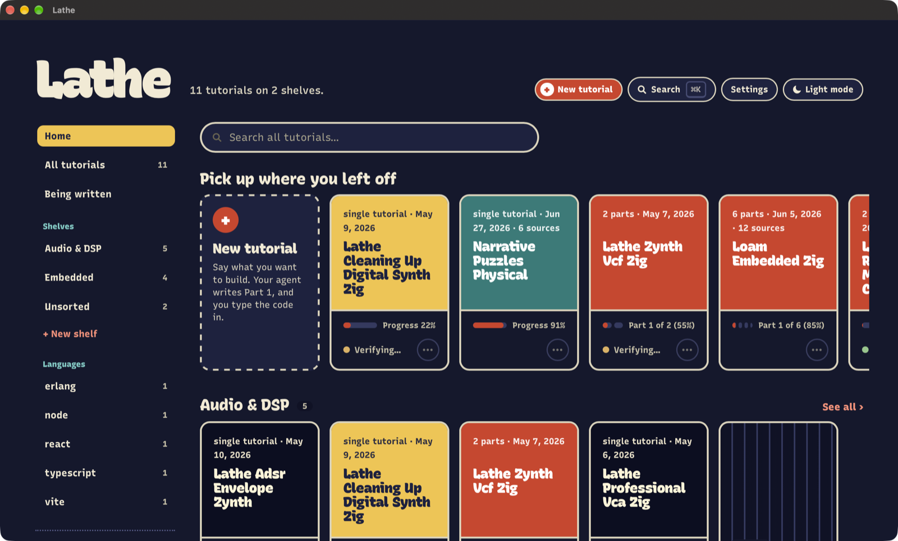
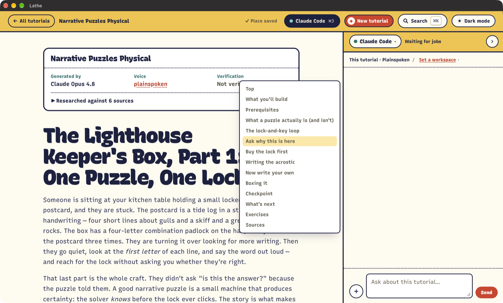
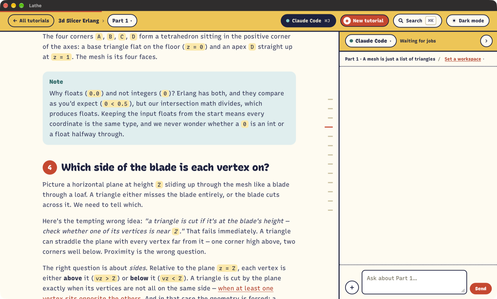
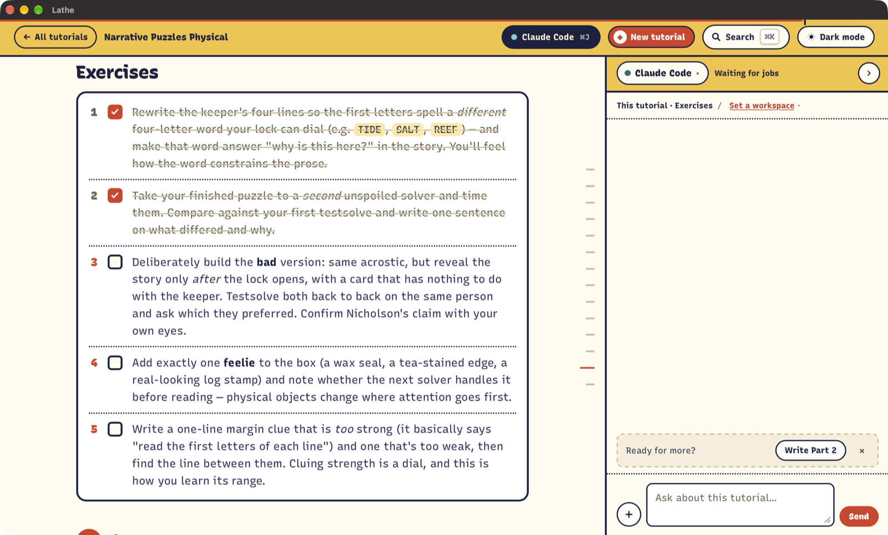
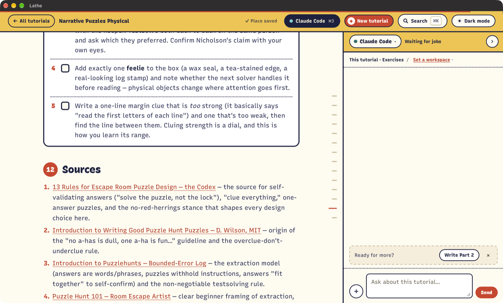

# Lathe

An experiment in using LLMs to teach you, rather than think for you.

Lathe is a desktop app for learning by building. Your coding agent writes a hands-on, multi-part technical tutorial on any topic. Then you work through it yourself, typing the code in by hand, in a reader built from the ground up for pleasant learning. (Just like we did it in the stone age 😎)



## What is it?

- Ask for a tutorial (single-part or a multi-part series) on anything you want to build
- Read it and type the code in yourself, in an app made for it
- Ask questions about the part you're on, have your agent verify the tutorial works, check your own code for hints, or add the next part
- Keep your tutorials on shelves, and search and filter your library
- Every tutorial records its sources, the model that wrote it, and the voice it was written in

Lathe never calls a model itself. It runs the coding agent you already use (Claude Code, Codex, Gemini CLI, opencode or Goose), under your own sign-in and plan.

## Install the app

### macOS 12 or later

With [Homebrew](https://brew.sh):

```bash
brew install --cask devenjarvis/tap/lathe
```

This puts `Lathe.app` in your Applications folder. Open it from Launchpad, Spotlight or the Dock like any other app.

Or download `Lathe_<version>_macos_universal.zip` from the [latest release](https://github.com/devenjarvis/lathe/releases/latest), unzip it, and drag `Lathe.app` into Applications.

> [!NOTE]
> Lathe is not notarized by Apple yet. The Homebrew install handles this for you. If you downloaded the zip, macOS blocks the first launch: open the app once, then go to **System Settings › Privacy & Security**, scroll to the message about Lathe and click **Open Anyway**. You only do this once.

### Windows 10 and 11

Download `lathe_<version>_windows_amd64.zip` (or `_arm64`) from the [latest release](https://github.com/devenjarvis/lathe/releases/latest), unzip it, and double-click `lathe.exe`. It uses the WebView2 runtime that ships with Windows.

### Linux

There is no packaged Linux app yet; build it from source. On Ubuntu 24.04:

```bash
sudo apt install libgtk-4-dev libwebkitgtk-6.0-dev
CGO_ENABLED=1 go install -tags desktop,production github.com/devenjarvis/lathe@latest
```

Then run `lathe` from your desktop session.

## Your first tutorial

The first time you open Lathe, a short setup walks you through three steps:

1. **Pick your agent.** Lathe lists the coding agents it finds on your computer that speak the [Agent Client Protocol](https://agentclientprotocol.com), and shows the install command for any that are missing. Claude Code needs its ACP adapter: `npm install -g @agentclientprotocol/claude-agent-acp`. Codex needs Zed's [`codex-acp`](https://github.com/zed-industries/codex-acp).
2. **Choose a code folder.** Each tutorial gets its own folder under this one, where you type its code. Lathe makes the folder and runs `git init` when you start a tutorial.
3. **Make your first tutorial.** Say what you want to build, for example *a 3D slicer in Erlang*, and click **Start writing**. Your agent researches and writes Part 1 while you watch.



After setup, start a new tutorial any time with **New tutorial** (⌘N, or Ctrl+N on Windows and Linux).

> [!TIP]
> No agent that speaks ACP? Continue without one. Lathe then gives you a `/lathe …` command to paste into any coding agent that has the Lathe skills installed (see [Using the CLI](#using-the-cli)).

## Using the app

### Your library

Home opens on *Pick up where you left off*: the New tutorial cover, anything being written, and what you're partway through. Below that comes one row per shelf.



Don't worry, we also have dark mode:



- **Shelves.** Every tutorial sits on one shelf. Make one with **+ New shelf**, then drag covers onto it, or use a cover's **⋯** menu › **Move to shelf**. Each shelf has its own page with sorting and grouping.
- **Search.** ⌘K searches every tutorial by title, topic, tag, repo and tool version, and runs any command in the app.
- **Trash.** **Move to Trash** in a cover's **⋯** menu (or ⌘⌫) moves a tutorial to the Trash, and a toast offers **Undo**. The Trash keeps tutorials for 30 days by default; change that in **Settings › Library**.

### Reading and working

Open a tutorial and read it like a book. The agent panel docks on the right (pop it out into its own window, or collapse it to a slim rail).

- **Ask.** Type a question about the part you're on. Your agent answers in the panel.
- **Check my work.** Each part's checkpoint has a **Check my work** button. Your agent copies your code to a scratch folder, runs the checkpoint and compares your code with the part. You get a hint first, then more help only if you ask: the step that covers it, where to look, and last of all the reference code. Your files are never changed.
- **Verify tutorial.** Your agent follows the whole tutorial in a fresh scratch folder and records whether every step works. Verified tutorials keep a runnable snapshot of the code at the end of each part.
- **Write Part N.** Ask for the next part when you're ready.

Lathe limits what the agent can touch for each job. Ask may read the tutorial and nothing else. Verify may write and run commands only in its scratch folder. The panel shows each file the agent reads and each request Lathe blocks. This is a policy Lathe applies, not an OS sandbox.

When Verify, a new part or Check my work finishes, the app sends a system notification.

### What makes the reader nice to learn in

#### Table of contents on the right side bar



#### Side-notes throughout that prompt you to think more deeply



#### Exercises left to the reader at the end of each tutorial



#### Sources for everything

Every tutorial keeps the research trail behind it: the pages your agent actually read while writing it. The reading page shows them under *Researched against N sources*, so you can check where the material came from rather than take the prose on faith.



### Writing voices

Every tutorial is written in a **voice**. A voice changes how the prose sounds. It does not change accuracy, research, citations, verification or structure. Two voices ship with Lathe:

- **`plainspoken`** (the default) — honest and precise, with no invented persona or fabricated first-person war stories. It's written to avoid anthropomorphizing the LLM that produced it.
- **`companion`** — an attempt at a warm, wry, first-person "friend at the keyboard".

Pick the voice in the New tutorial sheet, and change the default in **Settings › Voices**. If you don't like the voices that come with lathe that's cool, you do you: **Settings › Voices › New voice** lets you describe your own. Your agent drafts a sample in it, which you refine with a click (Shorter, Warmer, …) or your own words before you save.

Custom voices are instructed to not impersonate a real named person, fabricate credentials, or deny LLM authorship, and every voice is wrapped with a fixed preamble enforcing the same at generation time. Every tutorial carries an authorship byline at the top: `Generated by <Model> · voice <name>`, where the model is the specific LLM that wrote it (e.g. "Claude Opus 4.8"), and the voice name expands to show the full spec.

I fully recognize this is a cat and mouse game, and that any attempts at safety here can be circumvented. Unfortunately, whether I publish lathe or not the bad actors who want to flood the world with AI slop tutorials are already going full steam ahead. I want to do my part though to make it clear that lathe is NOT intended for writing content outside of your personal use for your personal learning. 

### Troubleshooting

**The app can't find my agent.** Apps opened from the Dock don't get the `PATH` your shell sets up. When it starts, Lathe runs your login shell once (`$SHELL -i -l`, with a 5-second limit) and picks up its `PATH`. If your agent still isn't found (it's installed somewhere your shell files don't add, or your shell is csh, tcsh or nu), add its folder in **Settings › Agent**, or list it in `~/.lathe/config.json`:

```json
{
  "agent_path": ["~/.nvm/versions/node/v22.11.0/bin", "/opt/homebrew/bin"]
}
```

If your shell startup files are slow or interactive, skip that work during the probe with `[ -n "$LATHE_RESOLVING_ENVIRONMENT" ] && return` (fish: `set -q LATHE_RESOLVING_ENVIRONMENT; and return`).

**Local or self-hosted models.** Lathe doesn't talk to any model itself, so a local LLM needs no Lathe-specific setup. Point your coding agent at a local OpenAI-compatible endpoint (e.g. [Ollama](https://ollama.com/)'s `http://localhost:11434/v1`). The bigger the local "thinking" model you can run, the better the tutorials: these are research- and explanation-heavy tasks, not mechanical edits.

## Why does this exist?

I learned how to program as a teen in the 2000s by building homebrew games for my PSP (PlayStation Portable) in Lua, and then in C++. Lots of what I learned at the time was through the small PSP homebrew community I'm incredibly grateful I got to be a part of, but I also owe much of that formative learning to free online resources and tutorials available on the internet (shoutout to [2007 cplusplus.com](https://web.archive.org/web/20070213043837/http://www.cplusplus.com/articles/Sacha1.html) - man does that site have a lot more ads now than it used to 😅). Eventually I became a professional software engineer and I spent the next decade "upskilling" (though usually to learn more interesting topics than needed for <dayjob>) by finding and consuming a wealth of technical blogs, and more importantly for my learning style - hands on tutorials. Resources like the [build-your-own-x repo](https://github.com/codecrafters-io/build-your-own-x), and [Crafting Interpreters](https://craftinginterpreters.com/), and the 1,000 other one-off tutorials that taught me everything from building [a raytracer](https://raytracing.github.io/books/RayTracingInOneWeekend.html), to [a timeseries database](https://nakabonne.dev/posts/write-tsdb-from-scratch/), to [a linear algebra matrix library](https://www.andreinc.net/2021/01/20/writing-your-own-linear-algebra-matrix-library-in-c/) and everything in between (seriously, I couldn't even begin to list all the amazing hands-on tutorials out there that have influenced me). 

Hands on learning is how I've always learned best. These tutorials gave me the learning curve I needed to go from zero-to-one in a brand new domain, but even more importantly they gave me footing and confidence to take it from one-to-two-to-ten on my own. 

Fast forward to 2026, and now we've got LLMs. I'm not going to go off topic about my complicated relationship with LLMs, but for writing software they are _interesting_ and in many cases they can be really productive! But they do most of the work for you, and with that work gone they also take away the part that helped me learn a new concept or domain. In some cases, that doesn't matter - we've got a product to ship and LLMs help us ship it faster - but for me and my joy in this field and hobby I still crave those "ah ha!" moments where something finally clicks and I have the confidence I need to begin shaping it into my own.

So lathe is an experiment in using LLMs to teach me, rather than think for me. To recreate those moments of hands-on learning that taught me to love this work, and marry it with the _potential_ of a broad "expert" LLM who can, in theory, teach me anything. I use lathe as a catalyst to get me started on projects I wouldn't know how to start in, and **can't find any existing human written resources to teach**. For example I first came up with lathe because I wanted to write a 3D Slicer Software from scratch (just finding documentation on g-code was a pain, shoutout to [reprap](https://reprap.org/wiki/G-code)). At the time of writing I'm diving into the world of embedded software development with Zig. Both of these cases lathe has been an effective tool in getting me from zero-to-one in obscure or extremely young domains where the human written resources just don't exist yet (and I wonder for how long humans will still bother writing tutorials if only the LLMs read them...).

## But what about hallucinations?

Are lathe tutorials as good as ones written by humans? Not in the slightest. But what they lack in heart, personality, and architectural soundness, they make up for by having the tutorial writer ready and waiting to answer all of your questions, always willing to fix or update their tutorial when it isn't _exactly_ what you wanted, and they actually complete writing all 6 parts to that series they started in 2018 (we've ALL been there 😁). Lathe is an LLM, and while I've built and tuned it to be as good as I know how to make it for this particular task, it's still going to fail in the ways LLMs fail. I recommend using the biggest "thinking" model you have access to (Opus, GPT-5 Codex, etc) as these tasks are less about iterative mechanical execution you might optimize for when programming, and more about researching, designing, and explaining a tangible concept from start to finish. 

Additionally, the risk for hallucinations in this context is, in my opinion, significantly lower. Lathe is built to help _you_ do the thinking, and is built around the expectation that you're the one typing this code out yourself. By reading through the guide and typing it out, you are actively engaged in the work and should be well positioned to naturally ask "wait, does that make sense?" when you come across something weird. At which point you can `/lathe-ask` (and sometimes the LLM comes back with _good_ reasoning I didn't have because it's a foreign domain, and I learn something) or just straight tell your LLM to update the tutorial. While I have no pedagogical credentials to back this up, I think I may be actually internalizing concepts better by catching and pushing back on perceived slip-ups of the LLM. YMMV. 

All of that said, if you can find a tutorial written by a human, I'd always reach for that first. I hope more often than not you do. But if you learn the same way I do and want to dive into a domain that is light on teaching materials, lathe is a pretty cool tool. Just remember it is an LLM and not a human. To help with this, I try to make it clear at all times what you are and are not getting. The lathe skills to write tutorials will tell you when it isn't sure about something it has written, and while I offer a more "personal" voice, I've defaulted to one that doesn't pretend to be something it isn't. 

## Be honest, did you vibecode this? Isn't that contradictory to your thesis?

Yep, lathe is "vibecoded". In this case, the scope and risk of lathe is low. It's a living thesis, for personal learning. That said, I've been using it daily lately and it's proven to be a useful and stable tool in my toolbox. I'm learning a lot by using it, and at this point I think it's good enough that others might benefit from it too. I expect the next few point releases to be some intentional code/architecture clean up to ensure it remains stable for others, and of course incorporate any feedback I get. 

That said, for the sake of transparency, today I test lathe for my own usecases - using Claude Code on macOS. Lathe is built to be agent-agnostic (the skills are a cross-tool standard and the CLI never calls a model itself), so other agents and platforms _should_ work, but I've only verified my own setup. If you're willing to try it on a different agent or OS and it does work, or you end up hitting a bump in the road, I'd love an issue letting me know either way!

## Alright then, how does it work?

Lathe has three parts:

- **The app** — the reader, your library and the agent panel. It stores tutorials in `~/.lathe/tutorials/` and owns all of Lathe's data.
- **Your coding agent** — does all the model work: writing, answering, verifying and checking. The app starts it over the [Agent Client Protocol](https://agentclientprotocol.com) and hands it the instructions for each job, so the agent needs no setup beyond its ACP adapter. Each job also gets Lathe's own MCP server, so the agent records results with typed tools.
- **Skills** — the instructions for each job, written in the cross-tool `SKILL.md` format: `/lathe` writes a tutorial, `/lathe-extend` adds a part, `/lathe-verify` checks that a tutorial works, `/lathe-ask` answers a question, `/lathe-check` gives hints on your code, `/lathe-tag` picks search tags, `/lathe-shelf` proposes shelves and `/lathe-voice` drafts a voice. The app uses them for you; you only install them yourself to run Lathe from a terminal agent (see below).

**The app never calls a model API itself.** It runs no `claude -p` or headless model run. Model work happens in the agent you chose, under whatever subscription or endpoint that agent uses.

**Billing for the hosted agent (checked 2026-11-06).** Claude's ACP adapter is built on the Claude Agent SDK. Anthropic paused the planned 2026-06-15 metering of Agent SDK, `claude -p` and third-party-app use, and as of its 2026-10-07 update, use signed in with a Claude plan still draws from your subscription limits ([Anthropic](https://support.claude.com/en/articles/15036540-use-the-agent-sdk-with-your-claude-plan), [Zed](https://zed.dev/blog/anthropic-subscription-changes)). Anthropic has said it will give notice before any change. If metering returns, a hosted Claude agent would likely count as Agent SDK use rather than interactive use. The `/lathe-work` loop (see below) is not affected, because it runs in your interactive session. Codex over `codex-acp` accepts a paid ChatGPT plan login, and API keys are optional ([codex-acp](https://github.com/zed-industries/codex-acp)).

## Using the CLI

The app is the same `lathe` binary as the command line tool. You don't need the CLI for day-to-day use; it exists so agents have a deterministic way to manage tutorials, and for people who prefer a terminal.

**Get it.** The Homebrew cask links `lathe` onto your `PATH`. On Windows, `lathe.exe` is the CLI when run from a terminal. Without the app:

```bash
curl -sSf https://raw.githubusercontent.com/devenjarvis/lathe/main/install.sh | sh   # macOS and Linux
go install github.com/devenjarvis/lathe@latest                                       # needs Go 1.26+
```

**Read in a browser.** `lathe serve` opens the same reader at `http://localhost:4242` (`--port` to change it; `--agent <cmd>` to host a specific ACP agent).

**Use a terminal agent.** Install the skills so your agent can find them, then run `/lathe build a 3D slicer in Erlang` in it:

```bash
lathe skills install                      # ./.claude/skills (this project)
lathe skills install --user               # ~/.claude/skills (all projects)
lathe skills install --agent cursor       # also: codex, gemini, opencode, cline, windsurf, antigravity, all
```

Run `/lathe-work` once in that agent while the app or `lathe serve` is running, and the app's buttons drive work in that session instead of the hosted agent. With neither a hosted agent nor `/lathe-work`, each button gives you the `/lathe-*` command to paste.

**Other commands you might want:**

```bash
lathe start <slug> [path]     # set the folder you'll type a tutorial's code in, then open it
lathe voice list              # voices; also show, set-default, add
lathe shelf list              # shelves; also new, set
lathe verify-cancel <slug>    # stop a stuck verification and restore the previous result
lathe rm <slug>               # move a tutorial to the Trash (--now deletes it)
```

**Storage.** Each tutorial is a folder in `~/.lathe/tutorials/<slug>/` with a `metadata.json` (title, topic, status, tags, parts, tools, sources, voice, model) and one markdown file per part. Your reading state sits beside it in small files that never touch `metadata.json`: `progress.json`, `exercises.json`, `workspace.json` and `checks.jsonl`. Shelves live in `~/.lathe/shelves.json`, the Trash in `~/.lathe/trash/`, and custom voices in `~/.lathe/voices/`.

**Code snapshots.** A verified tutorial keeps the reconstructed code for every part as git tags in `~/.lathe/tutorials/<slug>/code/`, so you can see exactly what a part changed:

```bash
git -C ~/.lathe/tutorials/<slug>/code diff part-03 part-04
```

Verification only makes sense where the tutorial's toolchain is installed. If a required tool is missing (e.g. no `zig` binary), the run is reported as **skipped** rather than failed: "couldn't verify here" is not the same as "broken."
